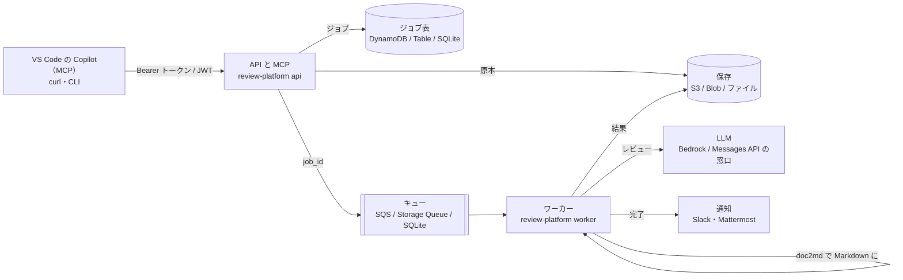

# review-platform

設計書（Excel・Word・PowerPoint・PDF・Markdown）とコードの差分を **AI でレビューする基盤** です。
HTTP の API と **MCP**（VS Code の Copilot や Claude から道具として呼べる）で受け付け、
キューを通してワーカーが **変換 → AI レビュー → 結果の保存 → 通知** を行います。

**同じコードが、ローカル（ファイルと SQLite）・AWS（S3・SQS・DynamoDB・Bedrock）・Azure（Blob・Queue・Table・Foundry）で動きます。**
クラウドの構成は Terraform で用意してあり、AWS と Azure の主要サービス・認証・閉域ネットワーク・費用の管理・MCP の公開を、1 つの題材で通して学べます。

> 一般的な構成の作例です。特定の企業・案件の構成の写しではありません。設計書の例（samples/）はすべて架空です。



## できること

| 送るもの | ワーカーがすること |
|---|---|
| 設計書（.xlsx .xlsm .docx .pptx .pdf .md） | [doc2md](https://github.com/shoyo-maya-bot/doc-to-markdown) で Markdown にし、変換ロスの警告を残す → 中位モデルがレビュー → MUST が出たら上位モデルがその指摘だけを検証 |
| コードの差分（.diff .patch） | [auto-review](https://github.com/shoyo-maya-bot/agent-lab/tree/main/auto-review)（危なさで振り分け、必要なときだけ上位モデルが検証） |

結果は Markdown（人が読む）と JSON（機械で扱う）の 2 つ。指摘ごとに **検証済み / 要確認 / 未検証 / 却下** が付きます。
**AI の指摘は下書きです。** 採否は人が決めます。

## すぐ試す（ローカル、5 分）

前提: Docker（Rancher Desktop など）と Python 3.11 以上。LLM は既定で `fake`（決まった返事）なので、API キーなしで一通り動きます。

```bash
git clone https://github.com/shoyo-maya-bot/review-platform.git && cd review-platform
pip install -e .                      # CLI（review-platform）を入れる
review-platform token                 # トークンと SHA-256 が表示される
cp .env.example .env                  # RP_API_TOKENS_SHA256 に、表示された SHA-256 を入れる
docker compose --profile local up -d --build
review-platform submit samples/member-api-design.xlsx --token <表示されたトークン> --wait
```

### Windows（PowerShell）で試す

Docker を使わず、API とワーカーを 2 つの PowerShell で動かします（保存先はローカルのフォルダ `.rp-data`）。
Excel・Word などの変換には doc2md が要るので、まず Markdown の設計書（`samples/member-api-design.md`）と差分（`samples/change.diff`）で試します。

```powershell
git clone https://github.com/shoyo-maya-bot/review-platform.git; cd review-platform
py -3.12 -m venv .venv; .\.venv\Scripts\Activate.ps1
pip install -e .                      # 変換も試すなら pip install -e ".[tools]"
review-platform token                 # トークンと SHA-256 が表示される
$env:RP_API_TOKENS_SHA256 = "<表示された SHA-256>"; $env:RP_LLM = "fake"
review-platform api                   # 1 つ目の PowerShell（http://127.0.0.1:8080）
```

```powershell
# 2 つ目の PowerShell（同じフォルダで .\.venv\Scripts\Activate.ps1 のあと、上と同じ環境変数を入れる）
$env:RP_API_TOKENS_SHA256 = "<表示された SHA-256>"; $env:RP_LLM = "fake"
review-platform worker
```

```powershell
# 3 つ目の PowerShell（送る側）
$env:RP_TOKEN = "<表示されたトークン>"
review-platform submit samples\member-api-design.md --wait
review-platform submit samples\change.diff --wait
```

本物の AI でレビューするときは、`.env` を `RP_LLM=anthropic` と `ANTHROPIC_API_KEY=...` にし、費用の上限 `RP_BUDGET_PER_JOB_USD`（1 件）・`RP_BUDGET_DAILY_USD`（1 日の全体）・`RP_BUDGET_DAILY_PER_OWNER_USD`（1 日の利用者ごと）を**すべて 0 より大きい値に**設定して起動し直します（費用がかかります）。上限の既定は 0 で、0 のままだと有料の LLM は一切呼びません（[CONFIG.md](docs/CONFIG.md)）。既定の疑似 LLM（`RP_LLM=fake`）は無料なので、上限 0 のままで動きます。
AWS・Azure の実装をローカルで試すときは、`--profile aws`（moto サーバー）か `--profile azure`（Azurite）で起動します。

### submit の終了コード

`review-platform submit` は、CI やスクリプトから結果で分岐できるよう、理由ごとに終了コードを分けます。どれもトレースバックではなく `error: ...` の 1 行を標準エラーに出します。

| コード | 意味 | 次にすること |
|---|---|---|
| `0` | 成功（`--wait` なら未解決の MUST なし。`--wait` なしなら受け付けた） | — |
| `1` | `--wait`: 結果に未解決の MUST がある | 結果を読んで直す |
| `2` | 送れなかった: 引数・ファイルを読めない・認証（401・403）・URL か job_id の誤り（404）・入力の誤り（400・413・415 など） | 表示された理由を直す（そのままやり直しても同じ） |
| `3` | 送れなかった・状態を読めなかった: 接続できない・通信の時間切れ・サーバーの誤り（5xx）・件数の上限（429）・API ではない応答 | 少し待ってからやり直す |
| `4` | `--wait`: `--timeout` の秒数までに終わらなかった（ジョブは動き続けている） | 表示された job_id で後から `GET /v1/jobs/<job_id>` |
| `5` | `--wait`: ジョブが失敗した（変換できない入力・予算の上限など. 理由を表示する） | 理由を読んで入力か設定を直す |

## VS Code の Copilot から使う（MCP）

`.vscode/mcp.json`（または利用者の設定）に追加します。

```json
{
  "servers": {
    "review-platform": {
      "type": "http",
      "url": "http://127.0.0.1:8080/mcp",
      "headers": { "Authorization": "Bearer ${input:rp-token}" }
    }
  },
  "inputs": [{ "id": "rp-token", "type": "promptString", "description": "review-platform のトークン", "password": true }]
}
```

Copilot Chat（エージェントモード）で「samples/member-api-design.md をレビューして」と頼むと、`submit_document` → `get_job` → `get_report` を呼びます。
詳しくは [docs/MCP.md](docs/MCP.md)。

## API

| メソッド | パス | 内容 |
|---|---|---|
| POST | `/v1/jobs` | 送る（multipart の `file`、または JSON の `filename` + `content_base64`）。202 と job_id |
| GET | `/v1/jobs` | 自分のジョブの一覧（新しい順） |
| GET | `/v1/jobs/{id}` | 状態（queued / running / succeeded / failed）と件数 |
| GET | `/v1/jobs/{id}/report?format=md\|json` | 結果 |
| POST | `/mcp` | MCP（Streamable HTTP） |
| GET | `/healthz` | 死活（認証なし） |

他人のジョブは「無い」（404）として扱います。

## クラウドに置く

| | 手順 | 構成 |
|---|---|---|
| AWS | [docs/AWS.md](docs/AWS.md) | ALB → ECS Fargate（API・ワーカー）、S3・SQS（DLQ）・DynamoDB・Bedrock、Cognito の JWT、NAT なし（VPC エンドポイント） |
| Azure | [docs/AZURE.md](docs/AZURE.md) | Container Apps（API・ワーカー、KEDA）、Blob・Queue・Table（プライベートエンドポイント）、Key Vault、Entra ID の JWT |

`terraform apply` と `destroy` は、必ず人が実行します（費用が発生します）。

## ドキュメント

| ページ | 内容 |
|---|---|
| [docs/ARCHITECTURE.md](docs/ARCHITECTURE.md) | 部品と責務、ジョブの状態、失敗とやり直し、設計の判断 |
| [docs/CONFIG.md](docs/CONFIG.md) | 環境変数（アプリ・Terraform・compose の共通の約束） |
| [docs/SECURITY.md](docs/SECURITY.md) | 脅威と対策、既知の妥協 |
| [docs/MCP.md](docs/MCP.md) | MCP の道具と使い方 |
| [docs/AWS.md](docs/AWS.md) / [docs/AZURE.md](docs/AZURE.md) | クラウドへの置き方・費用の試算・試験範囲との対応 |
| [docs/LEARNING.md](docs/LEARNING.md) | このリポジトリで学べること（AWS SAA・AZ-104・AZ-305・MCP） |
| [docs/COMPLETENESS.md](docs/COMPLETENESS.md) | 「完成」の定義と、何で確かめているか |

## 開発

```bash
pip install -c constraints.txt -e ".[aws,azure,dev]"   # constraints.txt は CI（deps-lock）が作る版の固定. 無ければ -c を外す
ruff check . && ruff format --check .
pytest -q                          # Azure の試験は RP_TEST_AZURITE（Azurite の接続文字列）があるときだけ
scripts/e2e.sh local               # docker compose で通しの試験（aws・azure も）
```

Windows（PowerShell）:

```powershell
py -3.12 -m venv .venv; .\.venv\Scripts\Activate.ps1
pip install -c constraints.txt -e ".[aws,dev]"
ruff check .; ruff format --check .
pytest -q                          # e2e（docker compose）は bash と Docker が要るので、WSL か CI で流す
```

CI は Linux（Python 3.11・3.12・3.14. イメージは 3.14）と Windows（3.12）でテストし、bandit・pip-audit・gitleaks・trivy も流します。

## 変更点

- **auto-review を agent-lab d4bc1c9 に上げた**（2026-10-08）. 文書（`*.md`・`docs/**`）だけの差分でも、秘密情報らしき値（`password=` など）があれば AI レビューを省かない（費用がかかることがある. 予算の確認は通常どおり）.
  上位モデルの段の出力が読めないときは、一次の結果を注記付きで返す（これまでと同じ）. review-platform はラベルを渡さないので、`review:standard` の固定は効かない（`tests/test_diff_auto_review_contract.py`）
- **`submit --wait` の終了コードを分けた**（2026-10-08）. これまでは「未解決の MUST あり」「送れなかった」「時間切れ」「ジョブの失敗」がどれも `1` だった.
  いまは MUST ありだけが `1` で、送れなかったは `2`・`3`、時間切れは `4`、ジョブの失敗は `5`（[submit の終了コード](#submit-の終了コード)）. `1` で判定しているスクリプトは見直す
- **ALB のアイドルタイムアウトの既定を 300 秒に**（2026-10-08. 下限 150 秒）. MCP の `get_job` は最大 120 秒待つので、既定の 120 秒では待っている間に切れることがあった. アプリの keep-alive は `RP_KEEP_ALIVE_SECONDS`（AWS は ALB + 5 秒）
- **doc2md の壊れた入力（終了コード 2）**は再試行せずに失敗にし、理由（stderr の要点. 一時フォルダのパスを外し、メールアドレス・電話番号を伏せる）をジョブの `error` に残す（2026-10-08）
- **AI の出力をスキーマで検証する**（2026-10-07）. 壊れた JSON（末尾のカンマなど）・`findings` という語を含むだけの文章・形の違う JSON
  （題名や重要度の無い指摘を含む）は、これまで「指摘 0 件の成功」になることがあったが、いまはジョブを **失敗**（「AI の出力を読めませんでした」）にする.
  上位モデルの検証の出力が読めないときは、一次の結果を「未検証」として出し、注記を残す
- **LLM の窓口（`ports.LLMClient.complete`）に `schema` 引数を足した**. Messages API・Bedrock は道具の強制で構造化出力にする. 独自の窓口を実装している場合は `schema=None` を受けるようにする
- **重要度の読み替え**は auto-review の表（`auto_review.findings.SEVERITY_ALIASES`）だけを使う. これまで review-platform だけの表で「読めない」としていた `P0`〜`P3` などは、auto-review と同じく読み替える
- **トークンの見積もり**: 日本語など ASCII 以外は 1 文字 1 トークンで数える（これまでは 3 文字で 1 トークン）. 日本語の長い文書は、予算の確認で止まりやすくなる
- **doc2md の子プロセス**には、決まった環境変数（PATH・HOME・TEMP・LANG・DEVTOOLS_* など）だけを渡す. API キーなどは渡さない

## セキュリティ・ライセンス

- 脆弱性を見つけたら、公開の Issue ではなく [SECURITY.md](SECURITY.md) の方法で知らせてください
- ライセンスは [MIT](LICENSE) です
