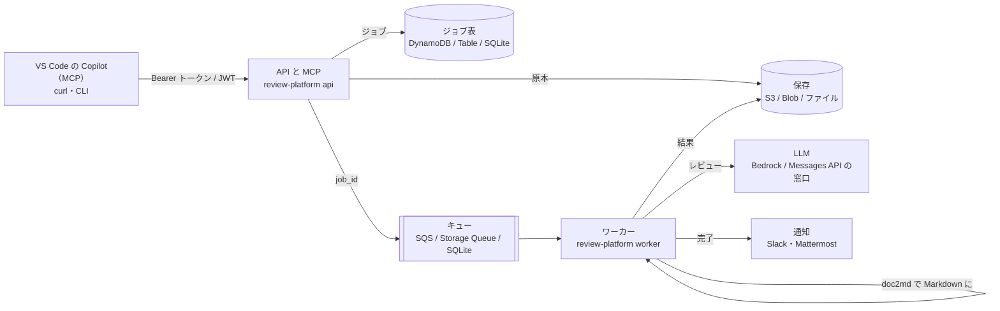

# review-platform

設計書（Excel・Word・PowerPoint・PDF・Markdown）とコードの差分を **AI でレビューする基盤** です。
HTTP の API と **MCP**（VS Code の Copilot や Claude から道具として呼べる）で受け付け、
キューを通してワーカーが **変換 → AI レビュー → 結果の保存 → 通知** を行います。

**同じコードが、ローカル（ファイルと SQLite）・AWS（S3・SQS・DynamoDB・Bedrock）・Azure（Blob・Queue・Table・Foundry）で動きます。**
クラウドの構成は Terraform で用意してあり、AWS と Azure の主要サービス・認証・閉域ネットワーク・費用の管理・MCP の公開を、1 つの題材で通して学べます。

> 一般的な構成の作例です。特定の企業・案件の構成の写しではありません。設計書の例（samples/）はすべて架空です。



## できること

| 送るもの | ワーカーがすること |
|---|---|
| 設計書（.xlsx .xlsm .docx .pptx .pdf .md） | [doc2md](https://github.com/shoyo-maya-bot/doc-to-markdown) で Markdown にし、変換ロスの警告を残す → 中位モデルがレビュー → MUST が出たら上位モデルがその指摘だけを検証 |
| コードの差分（.diff .patch） | [auto-review](https://github.com/shoyo-maya-bot/agent-lab/tree/main/auto-review)（危なさで振り分け、必要なときだけ上位モデルが検証） |

結果は Markdown（人が読む）と JSON（機械で扱う）の 2 つ。指摘ごとに **検証済み / 要確認 / 未検証 / 却下** が付きます。
**AI の指摘は下書きです。** 採否は人が決めます。

## すぐ試す（ローカル、5 分）

前提: Docker（Rancher Desktop など）と Python 3.11 以上。LLM は既定で `fake`（決まった返事）なので、API キーなしで一通り動きます。

```bash
git clone https://github.com/shoyo-maya-bot/review-platform.git && cd review-platform
pip install -e .                      # CLI（review-platform）を入れる
review-platform token                 # トークンと SHA-256 が表示される
cp .env.example .env                  # RP_API_TOKENS_SHA256 に、表示された SHA-256 を入れる
docker compose --profile local up -d --build
review-platform submit samples/member-api-design.xlsx --token <表示されたトークン> --wait
```

本物の AI でレビューするときは、`.env` を `RP_LLM=anthropic` と `ANTHROPIC_API_KEY=...` にして起動し直します（費用がかかります。1 件あたりの上限は `RP_BUDGET_PER_JOB_USD`）。
AWS・Azure の実装をローカルで試すときは、`--profile aws`（moto サーバー）か `--profile azure`（Azurite）で起動します。

## VS Code の Copilot から使う（MCP）

`.vscode/mcp.json`（または利用者の設定）に追加します。

```json
{
  "servers": {
    "review-platform": {
      "type": "http",
      "url": "http://127.0.0.1:8080/mcp",
      "headers": { "Authorization": "Bearer ${input:rp-token}" }
    }
  },
  "inputs": [{ "id": "rp-token", "type": "promptString", "description": "review-platform のトークン", "password": true }]
}
```

Copilot Chat（エージェントモード）で「samples/member-api-design.md をレビューして」と頼むと、`submit_document` → `get_job` → `get_report` を呼びます。
詳しくは [docs/MCP.md](docs/MCP.md)。

## API

| メソッド | パス | 内容 |
|---|---|---|
| POST | `/v1/jobs` | 送る（multipart の `file`、または JSON の `filename` + `content_base64`）。202 と job_id |
| GET | `/v1/jobs` | 自分のジョブの一覧（新しい順） |
| GET | `/v1/jobs/{id}` | 状態（queued / running / succeeded / failed）と件数 |
| GET | `/v1/jobs/{id}/report?format=md\|json` | 結果 |
| POST | `/mcp` | MCP（Streamable HTTP） |
| GET | `/healthz` | 死活（認証なし） |

他人のジョブは「無い」（404）として扱います。

## クラウドに置く

| | 手順 | 構成 |
|---|---|---|
| AWS | [docs/AWS.md](docs/AWS.md) | ALB → ECS Fargate（API・ワーカー）、S3・SQS（DLQ）・DynamoDB・Bedrock、Cognito の JWT、NAT なし（VPC エンドポイント） |
| Azure | [docs/AZURE.md](docs/AZURE.md) | Container Apps（API・ワーカー、KEDA）、Blob・Queue・Table（プライベートエンドポイント）、Key Vault、Entra ID の JWT |

`terraform apply` と `destroy` は、必ず人が実行します（費用が発生します）。

## ドキュメント

| ページ | 内容 |
|---|---|
| [docs/ARCHITECTURE.md](docs/ARCHITECTURE.md) | 部品と責務、ジョブの状態、失敗とやり直し、設計の判断 |
| [docs/CONFIG.md](docs/CONFIG.md) | 環境変数（アプリ・Terraform・compose の共通の約束） |
| [docs/SECURITY.md](docs/SECURITY.md) | 脅威と対策、既知の妥協 |
| [docs/MCP.md](docs/MCP.md) | MCP の道具と使い方 |
| [docs/AWS.md](docs/AWS.md) / [docs/AZURE.md](docs/AZURE.md) | クラウドへの置き方・費用の試算・試験範囲との対応 |
| [docs/LEARNING.md](docs/LEARNING.md) | このリポジトリで学べること（AWS SAA・AZ-104・AZ-305・MCP） |
| [docs/COMPLETENESS.md](docs/COMPLETENESS.md) | 「完成」の定義と、何で確かめているか |

## 開発

```bash
pip install -e ".[aws,azure,dev]"
ruff check . && ruff format --check .
pytest -q                          # Azure の試験は RP_TEST_AZURITE（Azurite の接続文字列）があるときだけ
scripts/e2e.sh local               # docker compose で通しの試験（aws・azure も）
```

## ライセンス

MIT
