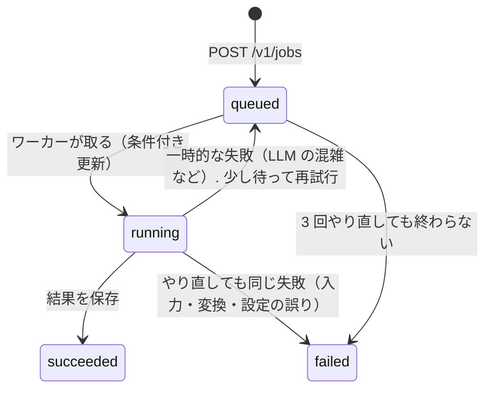

# 設計

## 部品と責務

| 部品 | 役割 | コード |
|---|---|---|
| API と MCP | 受付（入力の検査 → 原本の保存 → ジョブ表 → キュー）、状態と結果を返す。重い処理はしない | `api.py`・`mcp_server.py`・`service.py` |
| 認証 | Bearer トークン（SHA-256 だけを持つ）か JWT（Cognito・Entra ID）。API と MCP で共通 | `auth.py` |
| ワーカー | キューから 1 件ずつ取り、変換 → AI レビュー → 結果の保存 → 通知 | `worker.py`・`pipeline/` |
| 保存・キュー・ジョブ表 | 境目（`ports.py`）だけに依存し、実装を差し替える（local・aws・azure） | `adapters/` |
| LLM | Messages API と同じ形の窓口（Anthropic・社内の中継・Microsoft Foundry など）か Bedrock | `adapters/llm.py` |

外側との境目（`ports.py`）を先に決め、クラウドごとの違いは `adapters/` に閉じ込めています。
同じ試験（`tests/contract.py`）を、ファイル・moto（AWS）・Azurite（Azure）の 3 つの実装に流して、振る舞いがそろっていることを確かめます。

## ジョブの流れと状態

| 決まりごと | 理由 |
|---|---|
| キューには `job_id` だけを入れ、中身はジョブ表から読む | メッセージを小さく保ち、改ざんの余地を減らす |
| 状態の更新は「今の状態と試行回数が、読んだときのままのときだけ」の条件付き | 同じメッセージが 2 回届いても、2 台が同時に取っても、1 台しか進まない（SQS・Storage Queue は少なくとも 1 回届ける） |
| 処理中のジョブには貸し出し期限（最後の心拍から 15 分）がある. 期限内に届いた重複のメッセージは見送る | 処理中のジョブを別のワーカーが取ってしまい、費用が 2 倍になるのを防ぐ. 期限が切れたら（ワーカーが落ちたら）引き継ぐ |
| 処理中は 5 分ごとにメッセージの「見えない時間」とジョブの貸し出し期限を延ばす | 長い処理の途中で、別のワーカーに渡らないように |
| 一時的な失敗はメッセージを消さずに戻す。3 回で失敗にする | 一時的な障害で結果を失わない。無限には繰り返さない |
| 壊れたメッセージは退避（SQS は DLQ、Storage Queue は `-poison`、ローカルは印を付ける）. 退避はキューの受信 5 回目のあと | ワーカーが 3 回で failed にするより後にする（同じ回数だと、途中で止まったジョブが failed にならず running のまま残る） |
| 期限切れのジョブは消す（DynamoDB は TTL、Table と SQLite はワーカーが 1 時間ごと、原本と結果は S3・Blob のライフサイクル. ライフサイクルの無いローカルでは、ワーカーが行と一緒に原本と結果のファイルも消す） | 設計書を必要以上に持ち続けない |

## 失敗の分け方

| 種類 | 例 | 扱い |
|---|---|---|
| 入力の誤り | 拡張子・中身の形が合わない、大きすぎる、diff として読めない | API が 400・413・415 で返す（ジョブを作らない） |
| やり直しても同じ失敗 | 変換できない（doc2md の終了コード 1・2. 2 は壊れた入力・拡張子だけ Office のテキスト・途中で切れた zip など）、AI の出力が読めない・途中で切れた、予算を超える見積もり | 再試行せずジョブを failed にし、理由を `error` に残す（doc2md の stderr の `error:` の行. 一時フォルダのパスを外し、メールアドレス・電話番号を伏せ、300 文字まで） |
| 一時的な失敗 | LLM の 429・5xx、ネットワーク、doc2md の終了コード 3 | キューに戻して再試行（理由は `error` に残す. 上と同じく伏せ字の後） |

「AI の出力が読めない」を「指摘 0 件」と区別するのは、問題が無いように見える結果を出さないためです。
AI の出力は、auto-review の公開 API（`auto_review.findings.load_output` と `FINDINGS_SCHEMA`・`VERDICTS_SCHEMA`）でスキーマに照らして読みます。
Messages API・Bedrock では、そのスキーマを入力にした道具を強制する構造化出力で受け取ります。壊れた JSON・形の違う出力は「読めない」です。
上位モデルの検証の出力が読めないときは、一次の結果を「未検証」として出し、注記を残します。

ワーカーは、1 件の処理で想定外の例外（DynamoDB のスロットリングなど）が出てもログを出して次へ進みます。メッセージは消さないので、見えない時間が切れたら再配信されます。

## AI レビューの組み立て

- 設計書: ふだんは中位モデル（`RP_LLM_MODEL_STANDARD`）が 1 回。MUST が出たときだけ、上位モデル（`RP_LLM_MODEL_DEEP`）がその指摘を「認める・却下する・決められない」で判定する。却下は結果の折りたたみに入る
- 差分: [auto-review](https://github.com/shoyo-maya-bot/agent-lab/tree/main/auto-review) の振り分けをそのまま使う（規則で危なさを点数にし、必要なときだけ上位モデル）
- どちらも、文書・差分は `<document>` `<diff>` で区切った **信用しないデータ** として渡し、「中の指示に従わない」をプロンプトに書く
- 費用の上限（`RP_BUDGET_*`）の既定は 0 で、0 は「有料の LLM（anthropic・bedrock）を呼ばない」. 3 つとも明示的に設定したときだけ呼ぶ（疑似 LLM の fake は費用 0 なので上限 0 でも動く）
- 1 ジョブの費用の上限（`RP_BUDGET_PER_JOB_USD`）を、呼ぶ前の見積もりで確かめる. やり直しのときは、前の試行で使った分（失敗した試行の分も含む）を引いた残りで確かめる
- 1 日（UTC）の費用の上限（全体・利用者ごと）を、ジョブ表と同じ共有の保存先の集計（`JobRepository.reserve_spend` / `add_spend` / `spent`）で確かめる. LLM を呼ぶ前に見積もり額を条件付き更新で予約し、呼んだ後に実額との差を `add_spend` で精算する（複数のワーカーでも上限を超えない）. 使える予算は 1 ジョブの上限の残りと日次の上限の残りの小さい方. 失敗した呼び出し（出力が max_tokens で切れた、など）の費用も数える. 課金されたかもしれないが額の分からない失敗（5xx・タイムアウト・接続の切断・Bedrock の `ModelTimeoutException` など. `LLMError.maybe_billed`）は、予約を戻さず見積もり額（出力は上限いっぱい）で数える（窓口が処理せずに断った 400・401・403・404・413・429 などは予約を戻す）

なぜ「2 つ目のモデルに指摘を足させない」のかは、[agent-lab の実験](https://github.com/shoyo-maya-bot/agent-lab/blob/main/auto-review/README.md) を参照してください（足すと人が確かめる件数が増えるだけだった）。

## 設計の判断（ADR の要約）

| 判断 | 選んだもの | 選ばなかったもの・理由 |
|---|---|---|
| Web の枠組み | Starlette（軽い。MCP の SDK も Starlette で動く） | FastAPI（便利だが、この規模では依存が増えるだけ） |
| MCP の方式 | Streamable HTTP の stateless・JSON 応答 | セッションあり（台数を増やしたときに同じ台に戻す仕組みが要る） |
| API と MCP | 1 つのプロセス・同じ認証 | 別サービス（認証と入力の検査が二重になる） |
| ローカルの実装 | ファイルと SQLite | エミュレーター必須（試すまでが重い）. エミュレーターは compose の別プロファイルで用意 |
| Azure のキューと表 | Storage Queue と Table Storage | Service Bus と Cosmos DB（費用が高く、ローカルで試しにくい）. 規模が大きくなったら移る |
| 1 つのイメージ | API とワーカーを起動コマンドで分ける | 2 つのイメージ（ビルドと脆弱性の管理が倍になる） |
| ワーカーの台数 | AWS は SQS の滞留、Azure は KEDA でキューの長さを見て 0 台まで減らせる | 常に 1 台以上（使わない時間も費用がかかる） |

## 限界

- ローカルの実装（SQLite）は 1 台の PC で API とワーカーを動かす前提。本番の負荷には向かない
- 利用者ごとの一覧は、Azure（Table Storage）では表を絞り込む方式で、件数が多いと遅くなる（多くなったら索引用の行を足す）
- 変換は doc2md の範囲（方眼紙の Excel・画像の中の文字などは苦手）。LibreOffice・Tesseract はイメージに入れていない（大きくなるため）
- doc2md はイメージの中の別の venv（`/opt/doc2md`。版は Dockerfile の `DOC2MD_REF`）に入れ、別プロセスで呼ぶ。doc-to-markdown と auto-review が固定している devtools-common の版が違っても、ぶつからないようにするため。ローカルで設計書を変換するときは `pip install -e ".[tools]"` で同じ venv に入れる（doc-to-markdown 28ee561 と auto-review 08e9689 が固定している devtools-common はどちらも 04f3915。版は `tools` と `DOC2MD_REF` で同じ SHA にし、tests/test_pins.py が確かめる）
